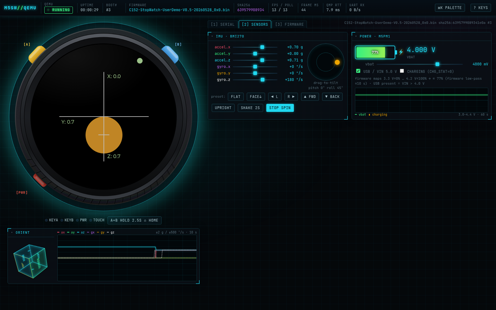
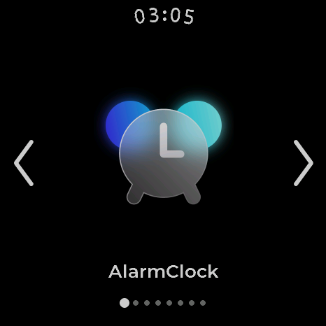
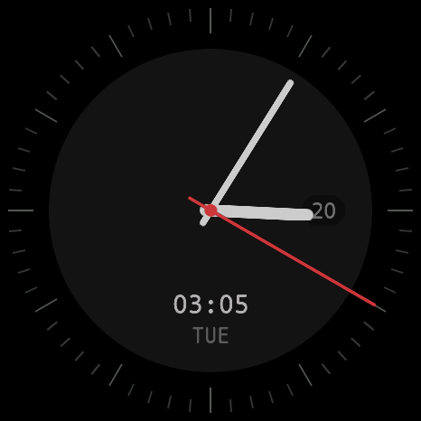
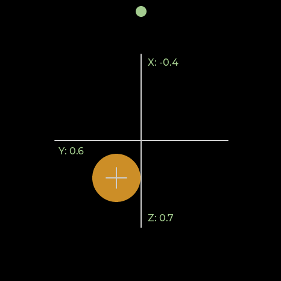
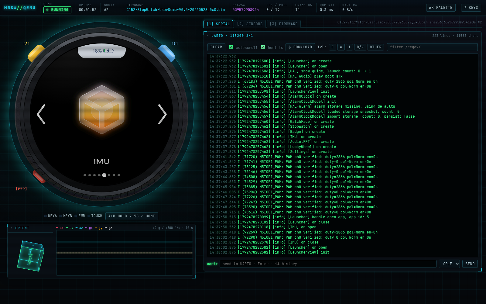
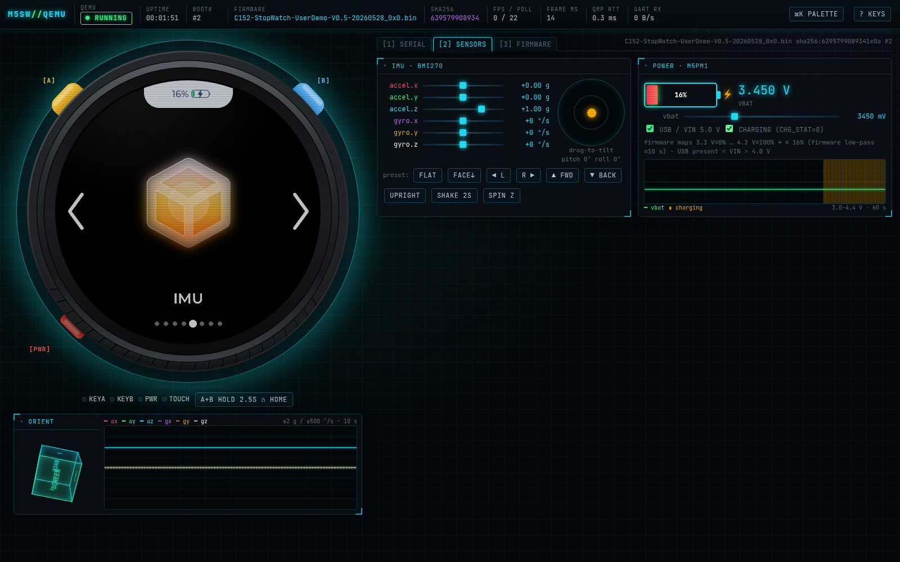

# M5StopWatch-QEMU

[](LICENSE) [](LICENSES/GPL-2.0.txt)

在 QEMU 中运行**未经修改**的 [M5Stack StopWatch](https://docs.m5stack.com/) 出厂固件（ESP32-S3，CO5300 466×466 AMOLED）：
显示、按键、触摸、IMU、电池、串口控制台和 Web 界面全部可用，无需硬件。

[English README](README.md)



| 启动器 | 表盘 | IMU 应用（QMP 设置加速度） |
|---|---|---|
|  |  |  |

## 功能

* 基于 Espressif QEMU 的新机器 `-M m5stopwatch`（5 个补丁，见 [docs/ARCHITECTURE.md](docs/ARCHITECTURE.md)）：
  八线 PSRAM、ESP32-S3 I2C 主机、GP-SPI2 + GDMA、CO5300 QSPI 屏、TE 信号、M5PM1 电源管理、M5IOE1 IO 扩展、
  CST820 触摸、BMI270 IMU、RX8130 RTC、ES8311（仅 ID）。
* 原样启动官方出厂镜像：引导页 → 启动器 → 表盘、秒表、IMU 等应用均可运行。
* 按键 A / B / 电源，A+B 长按，鼠标即触摸。
* **QMP 实时传感器**：加速度/角速度（g、°/s）、电池电压、USB/VIN、充电状态。
* **Web 界面**（`./run.sh --web`，仅依赖 Python 标准库，可离线）：可点击按键的设备外壳、HUD（状态/运行时间/启动次数/固件+sha256/fps/QMP 延迟）、
  彩色串口控制台（过滤、输入）、IMU 滑块 + 拖拽倾斜 + 预设 + 示波器 + 3D 姿态立方体、电量表与曲线、
  固件选择/上传/`?fw=`、快捷键（`?`）和命令面板（`Ctrl+K`）。
* **macOS arm64** 与 **Linux x86_64** 预编译自包含二进制（无需 Homebrew / apt 依赖）。

## 快速开始

下载对应平台的发布包并解压：

```bash
./run.sh                 # 原生窗口（macOS 为 Cocoa，Linux 为 SDL），串口日志输出到终端
./run.sh --web           # 浏览器打开 http://127.0.0.1:8466（需要 python3）
./run.sh --headless      # 无显示；串口在终端，QMP 在 run/qmp.sock
```

首次运行时 `run.sh` 会通过 `scripts/fetch-firmware.sh` 从
[M5StopWatch-UserDemo Releases](https://github.com/m5stack/M5StopWatch-UserDemo/releases) 下载官方出厂固件并校验 sha256。
macOS 上 `run.sh` 会自动去除 `bin/Darwin-arm64` 的下载隔离属性（二进制已 ad-hoc 签名）。

系统要求：Apple Silicon 上的 macOS 26 及以上，或 glibc ≥ 2.35 的 Linux x86_64（Ubuntu 22.04+、Debian 12+）。
`python3` 仅用于 `--web` 和辅助工具。其他平台请从源码构建。

### 命令行

| 选项 | 说明 |
|---|---|
| （无）/ `--sdl` | 原生 Cocoa 窗口（macOS）/ SDL 窗口 |
| `--web [--port N]` | Web 界面（QEMU 由 `web/server.py` 管理） |
| `--headless` | `-display none` |
| `--fw FILE.bin` | 固件：`firmware/` 中的文件名或任意 0x0 合并镜像路径（≤ 16 MB） |
| `--reset` | 重建 flash 镜像（清除 NVS/设置，重新进入引导页） |
| `--serial-tcp PORT` | UART0 映射到 `tcp:127.0.0.1:PORT`（客户端：`python3 tools/serial.py PORT`） |
| `--list` | 列出固件 |
| 环境变量 `QEMU=`、`ROMDIR=` | 指定其他 QEMU 二进制 / ROM 目录 |

按键：`A`/`←` = KEYA（黄），`B`/`→` = KEYB（蓝），`P` = 电源，A+B 按住约 2 秒 = 回主页。鼠标 = 触摸。
默认模式下 `Ctrl-A X` 退出，`Ctrl-A C` 切换 QEMU 监视器。

## Web 界面

`./run.sh --web` 启动 `web/server.py`，由它管理 QEMU 进程：

* 切换/上传固件或重置都会完全重启 QEMU，并用所选镜像生成**全新的 16 MB flash**；URL 中 `?fw=name.bin` 可直接启动该镜像；所有响应均为 `no-store`。
* UART0 从 ROM 第一行起通过 SSE 推送；输入框内容写入 UART0。
* 每次启动后自动重新应用传感器数值。

| | |
|---|---|
|  |  |

HTTP API 详见 [README.md](README.md#web-ui)。

## 传感器 / QMP

| QOM 路径 | 属性 | 单位 | 默认 |
|---|---|---|---|
| `/machine/bmi270` | `accel-x`、`accel-y`、`accel-z` | g（传感器坐标系） | 0, 0, 1 |
| `/machine/bmi270` | `gyro-x`、`gyro-y`、`gyro-z` | °/s | 0 |
| `/machine/m5pm1` | `vbat-mv`、`vin-mv`、`vinout-mv` | mV | 4000, 5000, 5000 |
| `/machine/m5pm1` | `charging` | bool | false |

```bash
(qemu) qom-set /machine/bmi270 accel-x 0.5
(qemu) qom-set /machine/m5pm1 vbat-mv 3500
python3 tools/qmp.py run/qmp.sock shot a.png key b sleep 1 tap 233 233
```

出厂固件将 VBAT 3.3 V 映射为 0 %、4.2 V 为 100 %（带慢速低通滤波）；VIN > 4 V 视为接入 USB。其 IMU 应用中 X/Y 轴互换（与实机一致）。

## 固件

| 文件 | 来源 | 是否随附 |
|---|---|---|
| `C152-StopWatch-UserDemo-V0.5-20260528_0x0.bin` | 官方出厂镜像，[m5stack/M5StopWatch-UserDemo](https://github.com/m5stack/M5StopWatch-UserDemo)（MIT） | 由 `scripts/fetch-firmware.sh` 下载 |
| `uart-echo-test.bin` | 本仓库 `firmware/uart-echo-test/`（ESP-IDF 5.5），把每行串口输入转大写回显 | 是 |

任何从 0x0 开始的 ESP32-S3 合并镜像（首字节 0xE9，≤ 16 MB）都可放入 `firmware/` 或在 Web 界面上传。依赖 Wi-Fi/BLE/音频或未建模硬件的固件可能卡住。

## 架构

CO5300 通过 GP-SPI2 + GDMA 的 QSPI 写帧并产生 TE；I2C 总线上挂 M5PM1（电源/电池）、M5IOE1（IO 扩展，按键/屏幕复位/电源使能）、
CST820、BMI270、RX8130、ES8311。详见 [docs/ARCHITECTURE.md](docs/ARCHITECTURE.md)。

## 局限

* 无 Wi-Fi/BLE、无 I2S 音频（ES8311 仅回应 ID）、无 BMM150 磁力计、无 BMI270 特征引擎（计步/手势）。
* 未建模 GPIO 中断（固件轮询按键）。
* 电池不做放电模拟，电压即为设置值。
* RTC 使用主机 UTC 时间（固件默认 GMT0）。
* TCG 仿真，大致实时但非周期精确；Web 显示为 PNG 轮询（画面变化时约 12–15 fps）。

## 从源码构建

```bash
scripts/build-macos.sh            # Homebrew 依赖；输出 bin/Darwin-<arch>/，捆绑 dylib 并 ad-hoc 签名
scripts/build-linux.sh            # apt 依赖；输出 bin/Linux-<arch>/
BUNDLE=1 scripts/build-linux.sh   # 可移植捆绑包（建议在 Ubuntu 22.04 上构建）
scripts/make-release.sh 0.1.0     # 生成发布包到 dist/
```

开发流程见 [AGENTS.md](AGENTS.md) 与 [CONTRIBUTING.md](CONTRIBUTING.md)。

## 许可

* **本项目自有代码采用 MIT**：`run.sh`、`scripts/`、`web/`、`tools/`、`firmware/uart-echo-test/`、文档。见 [LICENSE](LICENSE)。
* **例外（GPL-2.0-or-later）**：`patches/*.patch` 是对 QEMU 的修改，发布包中的 `bin/*/qemu-system-xtensa` 是 QEMU 构建产物，二者均为 GPL-2.0-or-later。
  对应源码：espressif/qemu tag `esp-develop-9.2.2-20260417` + `patches/` + 构建脚本（每个 Release 均附 `-src.zip`）。
* **捆绑的第三方库**（glib、SDL、pixman、libpng 等）保留各自许可（LGPL-2.1、Zlib、MIT、BSD 等），版本、源码地址及书面源码提供承诺见 [THIRD_PARTY_NOTICES.md](THIRD_PARTY_NOTICES.md)。
* **Espressif ROM**：`bin/*/esp32s3_rev0_rom.bin` 为 ESP32-S3 掩膜 ROM 镜像，版权归乐鑫信息科技（上海）股份有限公司（Espressif Systems），
  按 [espressif/qemu Releases](https://github.com/espressif/qemu/releases)（`pc-bios/`）中的原样再分发；对应 ROM ELF 发布于 [espressif/esp-rom-elfs](https://github.com/espressif/esp-rom-elfs)。
* **M5Stack 出厂固件**版权归 M5Stack（MIT），本仓库**不包含**，由 `scripts/fetch-firmware.sh` 从官方 Release 下载。

## 致谢

[Espressif QEMU](https://github.com/espressif/qemu)（GPL-2.0）、[M5Stack](https://github.com/m5stack/M5StopWatch-UserDemo)（硬件、出厂固件与驱动源码参考，MIT）、QEMU 项目及上述各库。

本项目与 M5Stack、Espressif 无隶属关系。
